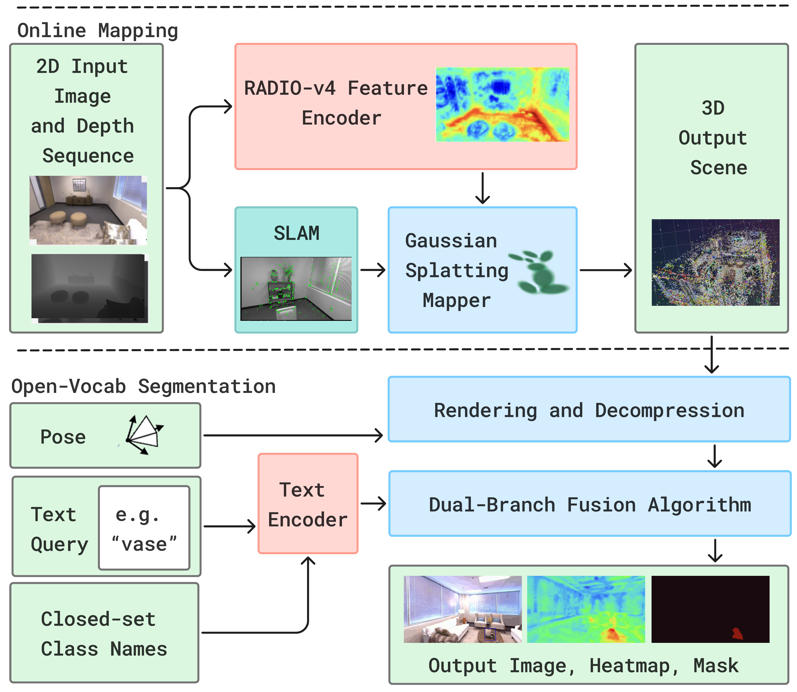
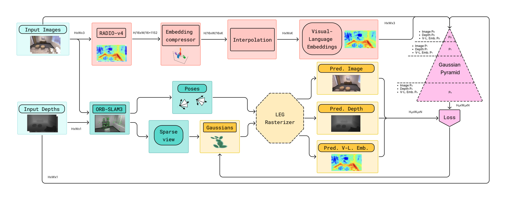
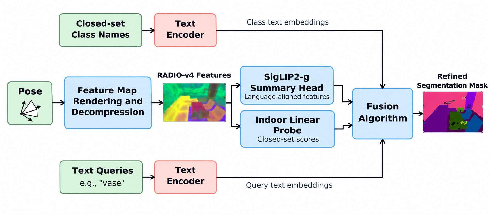
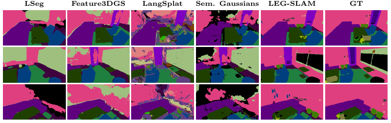
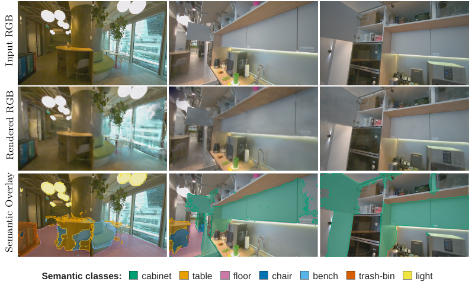

# LEG-SLAM: Language-Enhanced Gaussian Splatting for Real-Time SLAM

<p align="center">
  <strong>Online RGB-D SLAM · Photorealistic mapping · Open-vocabulary 3D scene understanding</strong>
</p>

<p align="center">
  <a href="https://github.com/zaid-nasser/LEG-SLAM/releases/tag/v1.0.0"></a>
  <a href="https://github.com/zaid-nasser/LEG-SLAM"></a>
  <a href="LICENSE"></a>
  
  
  
</p>

---

## Overview

LEG-SLAM is a **real-time RGB-D SLAM system** that combines:
- **3D Gaussian Splatting** for photorealistic online mapping,
- **PCA-compressed RADIO-v4 features** for efficient semantic scene encoding,
- **dual-branch semantic fusion** for robust open-vocabulary segmentation.

It enables both **dense scene reconstruction** and **language-guided semantic understanding** in a single online pipeline.

<p align="center">
  
</p>

### Highlights

- **Real-time** open-vocabulary semantic SLAM with Gaussian maps.
- **Photorealistic 3D reconstruction** with language-enhanced scene representation.
- **Dual-branch fusion** combines open-vocabulary predictions with indoor-specific semantic knowledge.
- **13.03 FPS** on Replica.
- **37.6% mIoU** on Replica and **55.4% mIoU** on ScanNet.

<details>
<summary><strong>Abstract</strong></summary>

Open-vocabulary semantic simultaneous localization and mapping (SLAM) enables language-guided scene understanding, but integrating high-dimensional visual features into real-time mapping while maintaining accurate semantic segmentation remains challenging. We present LEG-SLAM, a real-time RGB-D SLAM system that constructs photorealistic 3D Gaussian maps enriched with RADIO-v4 visual features compressed using principal component analysis (PCA). To improve semantic segmentation, we propose a dual-branch approach that combines language-aligned features with an indoor-specific semantic classifier through reliability- and query-aware fusion. This allows the system to exploit specialized semantic knowledge while preserving open-vocabulary flexibility. LEG-SLAM achieves mean intersection over union (mIoU) scores of 37.6% and 55.4% on Replica and ScanNet, respectively, with a processing throughput of 13.03 frames per second on Replica. On four Replica scenes, the proposed fusion improves mIoU from 25.91% using open-vocabulary-only inference to 35.25%.

</details>

---

## Method at a glance

<p align="center">
  
</p>

<p align="center">
  
</p>

---

## Qualitative results

### Replica semantic segmentation

<p align="center">
  
</p>

### Real-world kitchen sequence

<p align="center">
  
</p>

---
## Installation

The pipeline was tested on an NVIDIA RTX 5060 Ti with CUDA 12.8 and PyTorch 2.7.1. Other GPU architectures can be configured through Docker build arguments

```bash
git clone https://github.com/zaid-nasser/LEG-SLAM.git
cd LEG-SLAM
mkdir -p data results encoder_models
docker compose build
docker compose up -d --no-build
docker compose exec legs-slam-api bash
```

The first build compiles the required C++ and CUDA dependencies. Subsequent commands are run inside the container from `/workspace`.

---

## Model weights

Download the project-specific model files from the [LEG-SLAM model release](https://github.com/zaid-nasser/LEG-SLAM/releases/tag/v1.0.0) and place them in `encoder_models/` at the repository root.

| Model | Description |
| --- | --- |
| [`radio_v4_backbone.pt`](https://github.com/zaid-nasser/LEG-SLAM/releases/download/v1.0.0/radio_v4_backbone.pt) | C-RADIOv4-SO400M visual encoder exported to TorchScript for online SLAM |
| [`radiov4_pca.pt`](https://github.com/zaid-nasser/LEG-SLAM/releases/download/v1.0.0/radiov4_pca.pt) | PCA compressor (1152 → 128 dimensions) |
| [`radio_indoor37_linear_probe.pt`](https://github.com/zaid-nasser/LEG-SLAM/releases/download/v1.0.0/radio_indoor37_linear_probe.pt) | Indoor37 linear segmentation probe |
| [`radio_indoor37_prototypes.pt`](https://github.com/zaid-nasser/LEG-SLAM/releases/download/v1.0.0/radio_indoor37_prototypes.pt) | Semantic prototypes for dual-branch inference |

## Quick start
### Replica

```bash
python -m tools.slam.run \
    --dataset replica \
    --sequence data/Replica/office0 \
    --output results/replica/office0 \
    --orb-config cfg/ORB_SLAM3/RGB-D/Replica/office0.yaml \
    --gaussian-config cfg/gaussian_mapper/RGB-D/Replica/replica_rgbd.yaml
```

### ScanNet

```bash
python -m tools.slam.run \
    --dataset scannet \
    --sequence data/scannet/scene0378_01 \
    --output results/scannet/scene0378_01 \
    --orb-config cfg/ORB_SLAM3/RGB-D/ScanNet/scene0378_01.yaml \
    --gaussian-config cfg/gaussian_mapper/RGB-D/ScanNet/scannet.yaml
```

Add `--viewer` to enable the interactive viewer.

---

## Evaluation

Run SLAM for the scenes to be evaluated first. The `--recon-root` argument must point to the parent directory containing their reconstruction outputs.

### Semantic segmentation

**Replica (51 classes)**

```bash
python -m eval semantic \
    --protocol replica51 \
    --scenes office0 \
    --data-root data/Replica \
    --recon-root results/replica \
    --feature-model radio_v4_so400m \
    --radio-inference dual \
    --probe-checkpoint encoder_models/radio_indoor37_linear_probe.pt \
    --prototype-file encoder_models/radio_indoor37_prototypes.pt \
    --out-root results/evaluation/replica/semantic
```

**ScanNet (20 classes)**

```bash
python -m eval semantic \
    --protocol scannet12_20 \
    --scenes scene0378_01 \
    --data-root data/scannet \
    --recon-root results/scannet \
    --feature-model radio_v4_so400m \
    --scannet-label-file eval/scannetv2-labels.modified.tsv \
    --radio-inference dual \
    --probe-checkpoint encoder_models/radio_indoor37_linear_probe.pt \
    --prototype-file encoder_models/radio_indoor37_prototypes.pt \
    --out-root results/evaluation/scannet/semantic
```

For the open-vocabulary-only baseline, use `--radio-inference open_vocab` and omit the probe and prototype arguments.

### Reconstruction quality

**Replica**

```bash
python -m eval reconstruction \
    --protocol replica8 \
    --scenes office0 \
    --data-root data/Replica \
    --recon-root results/replica \
    --out-root results/evaluation/replica/reconstruction
```

**ScanNet**

```bash
python -m eval reconstruction \
    --protocol scannet12 \
    --scenes scene0378_01 \
    --data-root data/scannet \
    --recon-root results/scannet \
    --out-root results/evaluation/scannet/reconstruction
```

### Benchmark scenes

- **Replica:** `office0 office1 office2 office3 office4 room0 room1 room2`
- **ScanNet:** `scene0011_00 scene0011_01 scene0050_00 scene0050_01 scene0050_02 scene0231_00 scene0231_01 scene0231_02 scene0378_00 scene0378_01 scene0378_02 scene0518_00`

---

## Repository structure

```text
LEG-SLAM/
├── cfg/                 # ORB-SLAM3 and Gaussian mapper configs
├── data/                # Datasets (Replica / ScanNet)
├── encoder_models/      # Released model weights
├── eval/                # Evaluation scripts and utilities
├── results/             # Reconstruction and evaluation outputs
├── tools/               # Training, download, and SLAM entrypoints
└── docker-compose.yml   # Container entrypoint
```

---

## Acknowledgements

We gratefully acknowledge the authors and contributors of the following projects, which form the foundations of LEG-SLAM:

- [Photo-SLAM](https://github.com/HuajianUP/Photo-SLAM) — real-time Gaussian-based photorealistic mapping.
- [ORB-SLAM3](https://github.com/UZ-SLAMLab/ORB_SLAM3) — camera tracking and geometric SLAM.
- [RADIO](https://github.com/NVlabs/RADIO) — visual foundation models and language-aligned feature representations.
- [SigLIP2](https://huggingface.co/google/siglip2-giant-opt-patch16-384) — vision-language alignment.

We also acknowledge the creators of Replica and ScanNet for making their datasets available to the research community.


## License

See [LICENSE](LICENSE) and [LICENSE.md](LICENSE.md) for licensing information. Third-party components and pretrained model weights are subject to their respective licenses.
